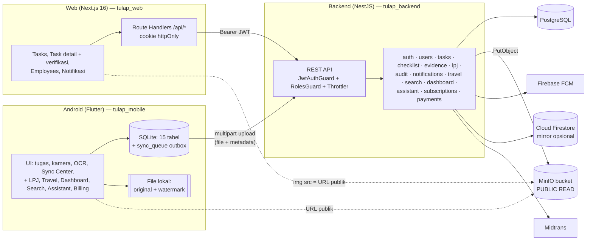
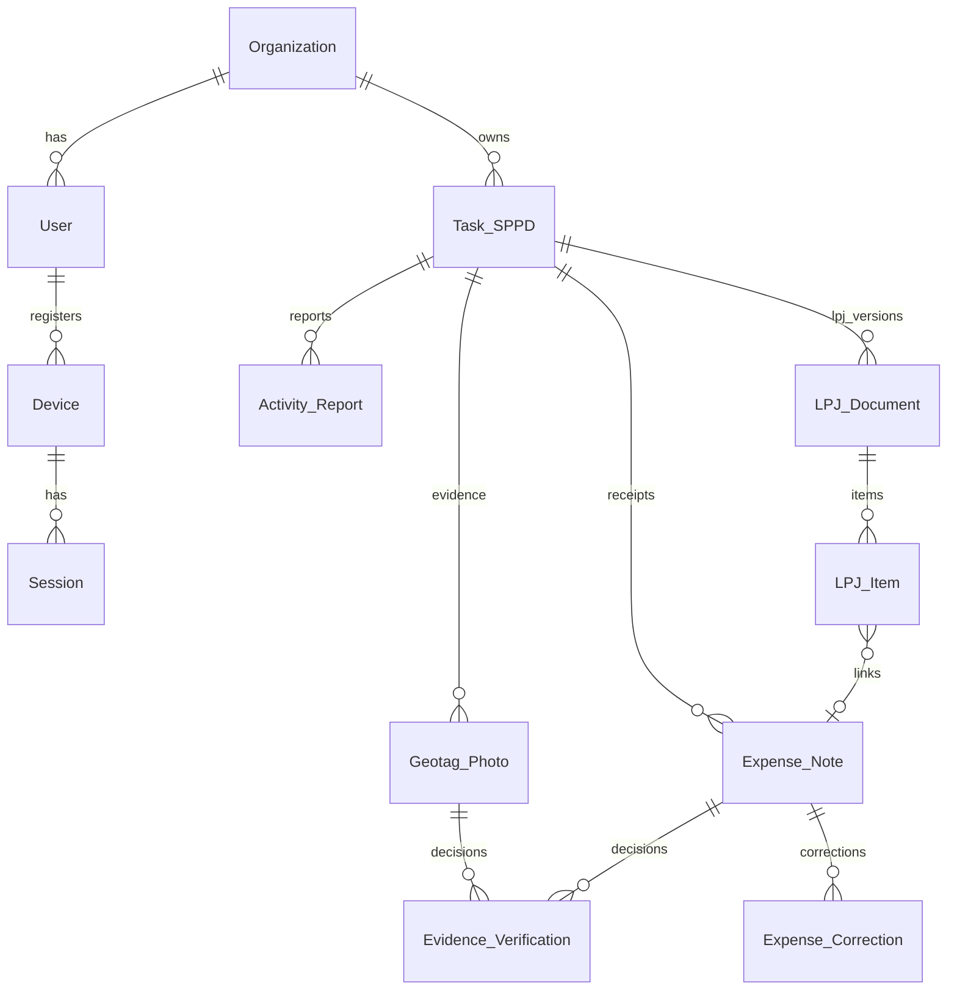
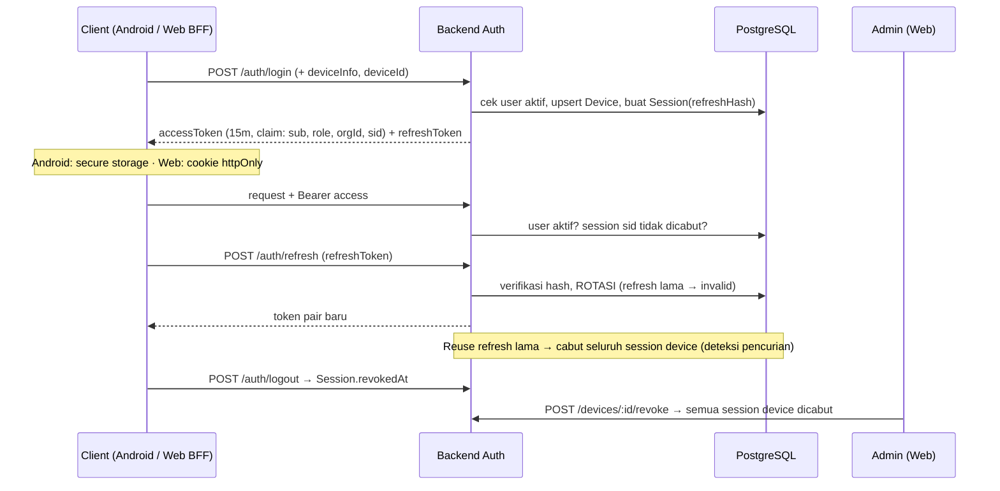
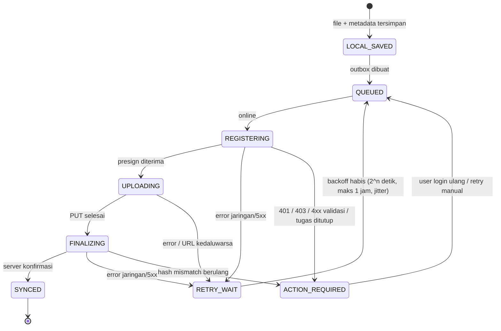
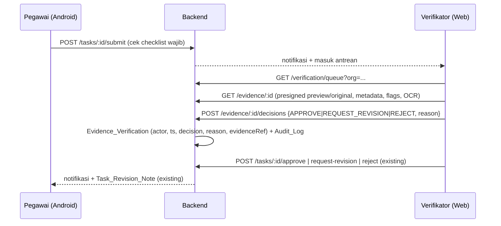

# TURLAP.ID — Target Architecture

**Tanggal:** 2026-10-13.
**Prinsip:** evolusi dari stack existing (NestJS + Prisma/PostgreSQL + MinIO, Flutter, Next.js). **Tanpa** penggantian framework dan **tanpa** microservices. Semua perubahan skema bersifat **aditif** (kolom nullable / tabel baru), tanpa drop dan tanpa reset.

---

## 1. Current Architecture



**Karakteristik saat ini:** file melewati memori API, bucket publik, verifikasi hanya per-tugas, laporan kegiatan tersimpan di Audit_Log, tidak ada worker, dan tidak ada scoping organisasi.

---

## 2. Target Architecture

```mermaid
flowchart LR
  subgraph Android["ANDROID = Field Operations"]
    A1[Login · Tugas saya · Detail & lokasi]
    A2[Kamera + GPS + watermark preview]
    A3[Scan nota + OCR on-device + koreksi]
    A4[(SQLite outbox<br/>state machine sync)]
    A5[Sync Center · Status perangkat]
    A1 --> A2 --> A4
    A3 --> A4
    A4 --> A5
  end

  subgraph Web["WEB = Management & Document Workspace"]
    W1[Dashboard · Drive · Search]
    W2[Verification Workspace]
    W3[Pengeluaran & koreksi OCR]
    W4[LPJ builder · versi · ekspor PDF/Word]
    W5[Pengguna · Role · Perangkat · Audit · Monitoring Sync]
    BFF[BFF Route Handlers<br/>cookie httpOnly + refresh]
    W1 & W2 & W3 & W4 & W5 --> BFF
  end

  subgraph Backend["BACKEND = Single Source of Truth (Modular Monolith NestJS)"]
    GW[API: Auth · RBAC · Org scope · Throttle · Helmet]
    EV[Evidence: register / presign / finalize]
    VR[Verification]
    EX[Expense & OCR review]
    LP[LPJ domain ber-versi]
    AU[Audit (append-only)]
    DV[Device & Session]
    JB[Job runner<br/>(in-process → queue bila perlu)]
    GW --> EV & VR & EX & LP & DV
    EV & VR & EX & LP & DV --> AU
    LP --> JB
    EV --> JB
  end

  PG[(PostgreSQL)]
  S3[(MinIO bucket PRIVAT<br/>original/ · preview/ · reports/)]
  MON[Logging & Monitoring]

  A4 -- "1 register · 3 finalize" --> GW
  A4 -- "2 PUT presigned" --> S3
  BFF --> GW
  W2 -. "GET presigned (TTL pendek)" .-> S3
  Backend --> PG
  Backend --> S3
  Backend --> MON
```

---

## 3. Component Responsibilities

| Komponen | Tanggung jawab | Bukan tanggung jawab |
|---|---|---|
| **Android** | Capture bukti (foto/video/nota), GPS + akurasi + waktu, watermark **preview**, OCR on-device + koreksi pegawai, penyimpanan offline, outbox sync, Sync Center, status perangkat, melihat tugas/hasil verifikasi | Keputusan verifikasi, pembuatan LPJ resmi, administrasi pengguna, analitik lintas pegawai |
| **Web** | Penugasan, Drive (navigasi bukti/dokumen), verifikasi per-bukti & per-tugas, koreksi OCR & pengeluaran, LPJ builder + ekspor + versi, pengguna/role/perangkat, audit viewer, monitoring sync, analitik | Capture bukti lapangan |
| **Backend** | AuthN/AuthZ (role + organisasi), validasi & state machine, idempotensi, otorisasi upload (presign), verifikasi integritas (hash server), penyimpanan keputusan, audit log, pembuatan laporan, notifikasi | Rendering UI |
| **PostgreSQL** | Satu-satunya sumber kebenaran data terstruktur | Penyimpanan file |
| **MinIO (privat)** | Objek biner: `original/`, `preview/`, `receipt/`, `reports/`, `avatar/` | Akses publik |
| **Job runner** | Generate PDF/Word LPJ, thumbnail, pemeriksaan hash pasca-upload | — |
| **Firestore mirror** | (Opsional, existing) dibiarkan apa adanya hingga keputusan D8 | Sumber kebenaran |

**Monolith tetap.** Alasannya: tim kecil, satu database, beban transaksi rendah–sedang. Job runner dimulai sebagai service in-process dan baru dipindah ke BullMQ + Redis bila ukuran PDF atau antrean membuktikan perlu.

---

## 4. Data Flow & Model Target (aditif)



**Prinsip model:**
- **`Geotag_Photo` tetap** (tidak di-rename, karena API dipakai mobile). Kolom baru nullable ditambahkan: `clientEvidenceId @unique`, `mediaType`, `mimeType`, `fileSizeBytes`, `gpsAccuracyMeters`, `gpsProvider`, `gpsFixAt`, `deviceCapturedAt`, `deviceId`, `captureSource`, `originalSha256`, `serverSha256`, `hashVerified`, `originalObjectKey`, `previewObjectKey`, `integrityFlags Json`, `verificationStatus`, `uploadState`, `deletedAt`.
- **`photoUrl` existing tetap terisi** selama masa transisi (kompatibilitas web/mobile lama).
- **`Expense_Note`**: kolom nullable `subtotal`, `taxAmount`, `discountAmount`, `serviceCharge`, `receiptNumber`, `paymentMethod`, `originalSha256`, `serverSha256`, `clientEvidenceId`, `deletedAt`. Kolom verifikasi existing mulai **benar-benar diisi**.
- **Tabel baru:** `Organization`, `Device`, `Session`, `Evidence_Verification`, `Expense_Correction`, `Activity_Report`, `LPJ_Document`, `LPJ_Item`.
- `User.organizationId` dan `Task_SPPD.organizationId` nullable, di-backfill dari `instansiName` lewat skrip terpisah yang dijalankan manual dengan persetujuan.

---

## 5. Authentication Flow (target)



**Kompatibilitas:** token lama (tanpa `sid`) tetap diterima sampai kedaluwarsa alami (≤7 hari). Setelah itu semua token memiliki `sid`.

---

## 6. Evidence Upload Flow (target)

```mermaid
sequenceDiagram
  participant M as Android
  participant L as SQLite outbox
  participant API as Backend
  participant S3 as MinIO (privat)
  M->>M: capture → simpan ORIGINAL + buat PREVIEW watermark (file terpisah)
  M->>M: SHA-256 original & preview, metadata GPS/waktu/device
  M->>L: LOCAL_SAVED → QUEUED (clientEvidenceId = UUID v4)
  L->>API: REGISTERING · POST /evidence (clientEvidenceId, taskId, metadata, sha256, size, mime)
  API->>API: cek pemilik tugas + status tugas; idempoten per clientEvidenceId
  API-->>L: evidenceId + presigned PUT (original, preview), TTL 15 mnt
  L->>S3: UPLOADING · PUT original, PUT preview
  L->>API: FINALIZING · POST /evidence/:id/finalize
  API->>S3: HEAD/GET → hitung SHA-256 server
  API->>API: hashVerified? flags (mock, root, hash_mismatch, accuracy>threshold)
  API-->>L: SYNCED (serverTimestamp, flags)
  Note over L: URL kedaluwarsa (403) → minta presign baru, ulang PUT (idempoten)
  Note over L: File lokal dihapus HANYA setelah SYNCED + masa retensi (mis. 30 hari) + ruang menipis
```

**Kompatibilitas mundur:** `POST /evidence/photo` dan `POST /evidence/receipt` (multipart) **tetap berfungsi** dan secara internal memakai logika register+finalize yang sama. Mobile versi lama tetap bisa sync.

---

## 7. Offline Synchronization Flow (state machine)



**Aturan recovery:**
- Saat app start, item dalam `REGISTERING/UPLOADING/FINALIZING` yang lebih tua dari N menit dikembalikan ke `QUEUED`. Ini aman karena server idempoten per `clientEvidenceId`.
- Pemetaan state existing → baru:
  - `pendingUpload` → `QUEUED`
  - `waitingForInternet` → `RETRY_WAIT`
  - `uploading` → `UPLOADING`
  - `synced` → `SYNCED`
  - `failed` → `ACTION_REQUIRED`

  Pemetaan dilakukan di model (baca nilai lama), **tanpa** menulis ulang tabel.

---

## 8. Verification Flow



Aturan:
- Keputusan **hanya** disimpan di backend.
- Alasan wajib untuk REQUEST_REVISION dan REJECT.
- Verifikator tidak dapat memverifikasi bukti miliknya sendiri.
- Setelah tugas VERIFIED, bukti terkunci: tidak dapat dihapus, hanya diarsipkan oleh ADMIN dengan alasan.

---

## 9. Receipt OCR Flow

```mermaid
flowchart LR
  C[Kamera nota] --> P[Preprocess: grayscale/crop/kontras<br/>receipt_image_processor.dart]
  P --> O[ML Kit on-device<br/>receipt_ocr_engine.dart]
  O --> R[Parser lokal<br/>receipt_parser.dart]
  R --> K[Koreksi pegawai<br/>receipt_detail / manual_expense]
  K --> S[(SQLite + outbox)]
  S --> B[Backend: Expense_Note<br/>+ field terstruktur + ocrRawText + confidence]
  B --> W[Web: review & koreksi<br/>Expense_Correction (before/after, actor)]
  W --> V[Verifikasi nota<br/>verifierId / verifiedAt / reason]
  V --> L[Dapat dipakai di LPJ]
```

OCR server-side **tidak** dibangun di fase awal. Hasil on-device + koreksi manusia sudah memenuhi target. OCR server hanya dipertimbangkan bila akurasi lapangan terbukti kurang.

---

## 10. LPJ Generation Flow

```mermaid
flowchart TD
  S[Pilih kegiatan / Travel Mission] --> E[Pilih bukti eligible:<br/>VERIFIED, tidak dihapus, hashVerified]
  E --> N[Tautkan nota ke item pengeluaran<br/>LPJ_Item ↔ Expense_Note]
  N --> V{Validasi:<br/>total, checklist wajib,<br/>nota terverifikasi}
  V -- gagal --> E
  V -- lulus --> G[Job: render PDF (pdfkit existing)<br/>+ Word (docx)]
  G --> ST[(MinIO reports/ + SHA-256)]
  ST --> D[LPJ_Document versi n<br/>contentSnapshot, status]
  D --> A[Audit_Log: LPJ_GENERATED v n]
```

- Format baseline adalah **PDF existing** (`lpj.service.ts`). Format resmi menunggu template yang disetujui (keputusan D6).
- `LPJ_Package` (Travel) dan laporan kegiatan mobile **dimigrasikan secara baca** ke `LPJ_Document`/`Activity_Report`. Data lama tidak dihapus.

---

## 11. Migration Strategy

1. **Expand → migrate → contract.**
   - Expand: tambah kolom/tabel nullable lewat migrasi Prisma baru yang di-review manual (`prisma migrate dev --create-only`, lalu baca SQL-nya).
   - Migrate: tulis ke kolom baru dan lama sekaligus (dual-write); backfill lewat skrip idempoten yang dijalankan manual.
   - Contract: kolom/endpoint lama baru dihentikan setelah semua klien terupdate, **dengan persetujuan**.
2. **Kompatibilitas API:** endpoint lama dipertahankan. Endpoint baru ditambahkan (`/evidence` register/finalize, `/evidence/:id/decisions`, `/devices`, `/activity-reports`, `/lpj/documents`). Field DTO lama tetap diterima.
3. **Feature flags** di mobile untuk alur upload baru dan penyembunyian layar MOVE_TO_WEB.
4. **Bucket publik → privat:**
   - (a) Backend mulai mengembalikan presigned GET.
   - (b) Web/mobile memakai URL tersebut.
   - (c) Setelah semua klien terupdate, anonymous read dicabut di MinIO. Langkah (c) adalah perubahan **production** dan butuh persetujuan.
5. **Data `Activity_Report` di Audit_Log:** disalin ke tabel baru; log audit **tidak dihapus** (append-only).
6. **Organization:** tabel + kolom nullable → backfill dari `instansiName` (skrip dry-run dulu) → scoping diaktifkan per-endpoint di balik flag.
7. **Rollback:** setiap migrasi aditif dapat dibiarkan (kolom nullable tidak mengganggu kode lama). Rollback dilakukan dengan menonaktifkan flag atau revert commit aplikasi, tanpa `DROP`.
