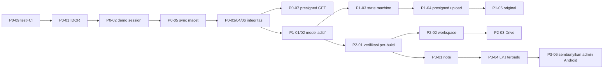

# TURLAP.ID — Implementation Roadmap

**Tanggal:** 2026-10-13
**Dasar:** `docs/architecture/EXISTING_SYSTEM_AUDIT.md`, `GAP_ANALYSIS.md`, `TARGET_ARCHITECTURE.md`
**Status:** USULAN. **Belum ada satu pun task yang dikerjakan.** Setiap task menunggu persetujuan.

## Aturan eksekusi (berlaku untuk semua task)

1. Sebelum mulai:
   - Jalankan `git status`.
   - **Jangan menyentuh** pekerjaan lokal yang belum di-commit: `fast_location_service.dart`, `location_fusion_engine.dart`, `quick_geotag/`, `account_page.dart`, `logout_protection_dialog.dart`, `task_detail_controller.dart`, `e2e/`, dan `git stash` "backup: redesain TURLAP…". Minta Anda meng-commit atau memutuskan nasibnya lebih dulu.
2. Satu task berarti satu branch dan satu PR kecil. Tidak ada commit, push, deploy, atau migrasi production tanpa persetujuan.
3. Migrasi Prisma hanya bersifat **aditif**: dibuat dengan `prisma migrate dev --create-only`, SQL dibaca manual, tanpa `DROP`, tanpa `migrate reset`.
4. Setelah setiap perubahan:
   - Jalankan test relevan + `tsc --noEmit` / `flutter analyze` / `eslint`.
   - Bandingkan dengan baseline (lihat `TASK_CHECKLIST.md` §0).
   - Catat hasil aktual.
5. Kegagalan test dibedakan menjadi **existing** (ada di baseline) atau **regresi baru**.

**Satuan estimasi:** hari-kerja untuk satu engineer full-stack yang sudah memahami repo, belum termasuk uji perangkat fisik dan review. Estimasi bersifat kasar dan diturunkan dari ukuran file serta jumlah titik sentuh yang ditemukan dalam audit.

---

## P0 — Data integrity, security, critical bugs

### P0-01 Tutup IDOR laporan kegiatan `/lpj/report/*`
- **Description:** tambahkan otorisasi kepemilikan tanpa mengubah skema.
  - `uploadReport` hanya untuk assignee tugas (atau ADMIN/SUPER_ADMIN).
  - `getTaskReports` dan `getReportById` mengikuti aturan akses `TasksService.findOne`.
  - `deleteReport` hanya untuk pengunggah atau ADMIN.
  - Query audit difilter di database (by `entityId`, JSON path `taskId`), bukan memuat semua log.
- **Existing files:** `tulap_backend/src/modules/lpj/lpj.service.ts`, `lpj.controller.ts`; spec baru `lpj.service.spec.ts`
- **Dependencies:** —
- **DB impact:** tidak ada
- **API impact:** respons 403/404 untuk akses tidak sah; bentuk respons sukses tidak berubah
- **Mobile impact:** tidak ada (mobile hanya mengakses laporan miliknya)
- **Web impact:** tidak ada
- **Testing:** unit test untuk 4 skenario × (pemilik, pegawai lain, verifikator, admin)
- **Acceptance:** PEGAWAI B mendapat 403 saat membaca, mengunggah, atau menghapus laporan tugas PEGAWAI A; pemilik tetap bisa
- **Rollback:** revert commit (tanpa perubahan data)
- **Estimasi:** 1 hari

### P0-02 Hapus fallback "demo admin" di web
- **Description:** blok `catch` di route login, Google, dan Apple mengembalikan 503 "Server tidak dapat dihubungi", **tanpa** `setSession`.
- **Existing files:** `tulap_web/src/app/api/auth/login/route.ts`, `google/route.ts`, `apple/route.ts`
- **Dependencies:** —
- **DB / API / Mobile impact:** tidak ada
- **Web impact:** login gagal secara eksplisit saat backend down
- **Testing:** jalankan web dengan `BACKEND_API_URL` mengarah ke port mati, pastikan tidak ada cookie yang terset; `eslint` + `tsc`
- **Acceptance:** tidak ada string `demo_` di `src/`; login dengan backend mati menampilkan error
- **Rollback:** revert commit
- **Estimasi:** 0,5 hari

### P0-03 Kunci penghapusan bukti setelah tugas dikirim
- **Description:** `deleteEvidencePhoto` dan `deleteEvidenceReceipt` ditolak (409) bila status tugas bukan `DRAFT/ONGOING/REVISION_NEEDED`. ADMIN pun tidak boleh menghapus bukti tugas VERIFIED/COMPLETED. Soft-delete dikerjakan di P1-01.
- **Existing files:** `tulap_backend/src/modules/evidence/evidence.service.ts`, `evidence.service.spec.ts`; mobile: pesan error di layar galeri/nota (`evidence_gallery`, `expense_ocr`)
- **Dependencies:** —
- **DB impact:** tidak ada
- **API impact:** kode error baru 409 untuk DELETE
- **Mobile impact:** tampilkan pesan "Bukti terkunci karena tugas sudah dikirim"
- **Web impact:** tidak ada
- **Testing:** unit test per status tugas; widget test pesan error
- **Acceptance:** DELETE bukti pada tugas `PENDING_VERIFICATION`/`VERIFIED`/`COMPLETED` → 409, data utuh
- **Rollback:** revert commit
- **Estimasi:** 0,5–1 hari

### P0-04 Rekam hasil verifikasi hash di server
- **Description:** migrasi aditif `Geotag_Photo.serverSha256 String?` dan `hashVerified Boolean?`. Server menyimpan hash hitungannya dan hasil perbandingan. Mismatch **tidak ditolak** (agar bukti tidak hilang) tetapi ditandai, dan ditampilkan sebagai flag merah di web. `integrityHash` tetap berisi klaim klien (kompatibilitas).
- **Existing files:** `prisma/schema.prisma` (+ migrasi baru), `evidence.service.ts`, `tulap_web/src/app/(dashboard)/tasks/[id]/page.tsx`, `tulap_web/src/lib/types.ts`
- **Dependencies:** —
- **DB impact:** 2 kolom nullable; data lama tetap `NULL` = "belum diperiksa"
- **API impact:** field tambahan di respons (aditif)
- **Mobile impact:** tidak ada
- **Web impact:** badge "Hash cocok / TIDAK cocok / belum diperiksa"
- **Testing:** unit test cocok/tidak cocok; review SQL migrasi; web `tsc` + `eslint`
- **Acceptance:** upload dengan hash salah tersimpan `hashVerified=false` dan tampil merah di detail tugas
- **Rollback:** revert kode; kolom nullable boleh dibiarkan
- **Estimasi:** 1 hari

### P0-05 Pulihkan item sync yang macet di `uploading`
- **Description:**
  - Saat `BackgroundSyncService.start()`, record `uploading` yang `lastAttemptAt` atau `createdAt`-nya lebih tua dari 5 menit diubah ke `waitingForInternet`. Ini aman karena server idempoten per `id`.
  - Sync Center menampilkan tombol "Coba Lagi" untuk `uploading` yang usianya lebih dari 5 menit.
- **Existing files:** `tulap_mobile/lib/core/sync/background_sync_service.dart`, `features/sync_queue/data/datasources/sync_local_datasource.dart`, `sync_queue_repository_impl.dart`, `widgets/sync_status_row.dart`; test baru di `test/features/sync_queue/`
- **Dependencies:** —
- **DB impact:** tidak ada (SQLite: hanya UPDATE status)
- **API impact:** tidak ada
- **Mobile impact:** item macet terkirim otomatis setelah app dibuka ulang
- **Web impact:** —
- **Testing:** unit test recovery; uji device: matikan app saat upload video besar, buka ulang, item tersinkron
- **Acceptance:** tidak ada record `uploading` yang bertahan setelah restart + 1 siklus sync
- **Rollback:** revert commit
- **Estimasi:** 1 hari

### P0-06 Cek kepemilikan pada jalur idempotensi upload
- **Description:** di `uploadPhoto`/`uploadReceipt`, cabang `existingById` hanya mengembalikan record jika `uploaderId/ownerId === actor.id`. Jika tidak, kembalikan 409 tanpa membocorkan URL.
- **Existing files:** `evidence.service.ts`, `evidence.service.spec.ts`
- **Dependencies:** —
- **DB impact:** —
- **API impact:** 409 untuk ID bentrok milik user lain
- **Mobile impact:** — (UUID v4 klien praktis tidak bentrok)
- **Web impact:** —
- **Testing:** unit test
- **Acceptance:** user B mengirim `id` milik foto user A → 409, tidak ada `photoUrl` di respons
- **Rollback:** revert
- **Estimasi:** 0,5 hari

### P0-07 Akses file privat (presigned GET), bertahap
- **Description:**
  - (a) `S3StorageService.getSignedReadUrl(key, ttl)` (`@aws-sdk/s3-request-presigner`).
  - (b) Endpoint yang mengembalikan bukti/laporan menambahkan `photoSignedUrl`/`scanSignedUrl` (field lama tetap ada).
  - (c) Web dan mobile memakai field signed bila tersedia.
  - (d) **Langkah production terpisah, butuh persetujuan:** cabut anonymous read bucket.
- **Existing files:** `src/infrastructure/storage/s3-storage.service.ts`, `evidence.service.ts`, `tasks.service.ts` (`getEvidence`), `lpj.service.ts`, `users.service.ts` (avatar); web `tasks/[id]/page.tsx`; mobile model foto/nota/laporan
- **Dependencies:** P0-01
- **DB impact:** tidak ada (kunci diturunkan dari URL lewat `keyFromUrl`)
- **API impact:** field aditif
- **Mobile impact:** model membaca field signed, fallback ke URL lama
- **Web impact:** `` memakai signed URL
- **Testing:** unit test signer; uji manual dengan bucket privat di MinIO **lokal**
- **Acceptance:** dengan bucket lokal privat, web dan mobile tetap menampilkan foto; URL lama → 403
- **Rollback:** (a)–(c) revert kode; (d) set ulang `mc anonymous set download`
- **Estimasi:** 3–4 hari

### P0-08 Isolasi organisasi (bersyarat pada keputusan D1)
- **Description:**
  - Tabel `Organization`, plus `User.organizationId?` dan `Task_SPPD.organizationId?`.
  - Skrip backfill dari `instansiName` (dry-run → laporan → eksekusi manual).
  - Claim `orgId` di JWT.
  - Filter org di tasks, evidence, users, search, dashboard, lpj, dan audit untuk VERIFIKATOR/ADMIN. SUPER_ADMIN lintas org.
  - Diaktifkan per-endpoint di balik flag `ORG_SCOPING_ENABLED`.
- **Existing files:** `schema.prisma`, `seed.ts`, `auth.service.ts`, `jwt.strategy.ts`, `authenticated-user.interface.ts`, service-service di atas; web `employees` (pilih org)
- **Dependencies:** keputusan D1
- **DB impact:** 1 tabel + 2 kolom nullable + backfill
- **API impact:** hasil list menyempit sesuai org
- **Mobile impact:** tidak ada (PEGAWAI sudah dibatasi per-user)
- **Web impact:** pegawai & tugas hanya untuk org sendiri
- **Testing:** spec per-service: verifikator org A tidak melihat tugas org B; dry-run backfill di DB lokal salinan
- **Acceptance:** matriks akses lintas org lulus; flag off = perilaku lama
- **Rollback:** matikan flag; kolom dibiarkan
- **Estimasi:** 5–8 hari

### P0-09 Perbaiki test "time-bomb" dan jalankan test di CI backend
- **Description:**
  - `subscriptions.service.spec.ts:47-58` memakai `currentPeriodEnd: 2026-10-01` yang kini sudah lewat, sehingga gagal sejak 2026-10-02. Ganti dengan tanggal relatif atau `jest.useFakeTimers().setSystemTime`.
  - Tambah `npm test` ke `backend-ci.yml`.
- **Existing files:** `src/modules/subscriptions/subscriptions.service.spec.ts`, `.github/workflows/backend-ci.yml`
- **Dependencies:** —
- **DB / API / Mobile / Web impact:** —
- **Testing:** `npx jest` → 68/68
- **Acceptance:** suite hijau; CI menjalankan test
- **Rollback:** revert
- **Estimasi:** 0,5 hari

### P0-10 Jangan ekspos Postgres di compose production
- **Description:** hapus `ports: 5432:5432` (atau bind ke `127.0.0.1`); dokumentasikan variabel `POSTGRES_*` lewat `.env`. **Verifikasi server aktual butuh akses dan persetujuan Anda.**
- **Existing files:** `tulap_backend/docker-compose.prod.yml`, `RUNBOOK.md`
- **Dependencies:** —
- **DB impact:** tidak ada data yang berubah
- **API / Mobile / Web impact:** —
- **Testing:** `docker compose config` lokal
- **Acceptance:** compose tidak mem-publish 5432 ke publik
- **Rollback:** revert file
- **Estimasi:** 0,5 hari (+ waktu ops di server)

**Total P0:** ±9–10 hari tanpa P0-08; ±15–18 hari dengan P0-08.

---

## P1 — Android field capture & reliable sync

### P1-01 Perluas model Evidence (aditif) + simpan metadata yang selama ini dibuang
- **Description:**
  - Tambah kolom nullable ke `Geotag_Photo` (lihat TARGET_ARCHITECTURE §4) + `deletedAt`.
  - `uploadPhoto` menyimpan `gpsAccuracyMeters`, `deviceTimestamp`, `originalHash`, `mediaType`, `mimeType`, `fileSize`, `altitude`, `heading`, `evidenceId` (short ID) yang sudah dikirim mobile.
  - Hapus bukti berubah menjadi soft-delete.
- **Existing files:** `schema.prisma`, `evidence.service.ts`, `dto/upload-photo.dto.ts`, `tasks.service.ts`, `search.service.ts`, `lpj.service.ts` (filter `deletedAt`)
- **Dependencies:** P0-03, P0-04
- **DB impact:** ±15 kolom nullable
- **API impact:** respons aditif
- **Mobile impact:** tidak ada (payload sudah dikirim)
- **Web impact:** detail tugas menampilkan akurasi GPS, waktu perangkat vs server, tipe media (video diputar dengan `<video>`)
- **Testing:** unit test persist; review SQL; regresi `evidence.service.spec.ts`
- **Acceptance:** upload dari mobile existing menghasilkan baris dengan kolom baru terisi
- **Rollback:** revert kode; kolom dibiarkan
- **Estimasi:** 2 hari

### P1-02 Simpan field nota yang dibuang + kategori lengkap
- **Description:** kolom nullable `subtotal`, `taxAmount`, `discountAmount`, `serviceCharge`, `receiptNumber`, `paymentMethod`, `notes`, `originalSha256`, `processedSha256`, `deletedAt`. Enum `ExpenseCategory` ditambah `ATK`, `PERLENGKAPAN` (`ALTER TYPE … ADD VALUE`, aditif).
- **Existing files:** `schema.prisma`, `evidence.service.ts` (`_mapCategory`), `dto/upload-receipt.dto.ts`
- **Dependencies:** —
- **DB impact:** kolom nullable + nilai enum baru
- **API impact:** aditif
- **Mobile impact:** —
- **Web impact:** tampilkan rincian nota
- **Testing:** unit test mapping kategori
- **Acceptance:** nota ATK tersimpan sebagai `ATK`, bukan `LAINNYA`
- **Rollback:** revert kode (nilai enum tidak dihapus)
- **Estimasi:** 1 hari

### P1-03 State machine sync target + exponential backoff
- **Description:**
  - Tambah state `LOCAL_SAVED…ACTION_REQUIRED` di domain, dengan pemetaan baca dari nilai lama (TARGET_ARCHITECTURE §7).
  - Kolom SQLite `nextAttemptAt` (ALTER TABLE ADD COLUMN, migrasi lokal aditif).
  - Backoff `min(2^n × 10s, 1 jam)` + jitter.
  - 4xx validasi dan 401 → `ACTION_REQUIRED` dengan pesan spesifik.
  - Sync Center menampilkan grup "Perlu tindakan".
- **Existing files:** `sync_record_entity.dart`, `sync_record_model.dart`, `local_database.dart` (`_onUpgrade`), `process_sync_queue.dart`, `sync_queue_repository_impl.dart`, `background_sync_service.dart`, `sync_center_page.dart`, `sync_status_row.dart`, `account_local_datasource.dart:129`, `account_controller.dart:168`
- **Dependencies:** P0-05
- **DB impact:** SQLite kolom baru (aditif); server tidak berubah
- **API impact:** —
- **Mobile impact:** perilaku retry berubah
- **Web impact:** —
- **Testing:** unit test pemetaan state lama→baru, backoff, klasifikasi error; uji upgrade DB dari versi lama (database fixture); uji device mode pesawat → online
- **Acceptance:** data SQLite versi lama terbaca benar setelah upgrade; tidak ada item hilang
- **Rollback:** revert kode; kolom `nextAttemptAt` diabaikan versi lama
- **Estimasi:** 2–3 hari

### P1-04 Alur upload register → presigned PUT → finalize (kompatibel mundur)
- **Description:**
  - Backend: `POST /evidence` (register, idempoten per `clientEvidenceId`), `POST /evidence/:id/upload-url` (presign ulang), `POST /evidence/:id/finalize` (HEAD + hash server + flags).
  - Endpoint multipart lama tetap ada.
  - Mobile: klien baru di balik flag `USE_PRESIGNED_UPLOAD`, termasuk penanganan URL kedaluwarsa.
- **Existing files:** `evidence.controller.ts`, `evidence.service.ts`, `s3-storage.service.ts`; mobile `sync_remote_datasource.dart`, `dio_client.dart`
- **Dependencies:** P1-01, P1-03, P0-07(a)
- **DB impact:** memakai kolom `uploadState`, `clientEvidenceId` (P1-01)
- **API impact:** endpoint baru; lama tetap
- **Mobile impact:** flag default OFF hingga diuji di device
- **Web impact:** —
- **Testing:** unit + e2e backend dengan MinIO lokal; uji device: putus jaringan di tengah PUT, URL kedaluwarsa, restart app di setiap state
- **Acceptance:** 0 duplikat dan 0 kehilangan pada 50 upload dengan gangguan jaringan acak
- **Rollback:** flag OFF → kembali ke multipart
- **Estimasi:** 5–7 hari

### P1-05 Unggah file original selain preview watermark (keputusan D7)
- **Description:** mobile sudah menyimpan `originalFilePath` + `originalHash` (`geotag_camera_local_datasource.dart:74-119`). Keduanya diunggah ke `original/`, sedangkan preview ke `preview/`. Video: hash saja dulu.
- **Existing files:** `sync_remote_datasource.dart`, `evidence.service.ts`, `s3-storage.service.ts`
- **Dependencies:** P1-04, D7
- **DB impact:** `originalObjectKey`, `previewObjectKey` (P1-01)
- **API impact:** aditif
- **Mobile impact:** penggunaan data seluler naik (perlu opsi "hanya Wi-Fi untuk original")
- **Web impact:** tombol "Lihat original"
- **Testing:** hash original server = `originalHash` klien
- **Acceptance:** setiap foto baru memiliki 2 objek ber-hash terverifikasi
- **Rollback:** flag
- **Estimasi:** 2 hari

### P1-06 Device & Session: rotasi refresh token, logout, revoke
- **Description:**
  - Tabel `Device`, `Session(refreshTokenHash, revokedAt)`.
  - Claim `sid`; rotasi refresh + deteksi reuse.
  - `POST /auth/logout`; `GET /devices/me`; `POST /devices/:id/revoke` (ADMIN).
  - Token lama tanpa `sid` diterima sampai kedaluwarsa.
- **Existing files:** `schema.prisma`, `auth.service.ts`, `auth.controller.ts`, `jwt.strategy.ts`, `notifications.service.ts` (kaitkan `DeviceToken`); mobile `dio_client.dart`, auth datasource, halaman keamanan akun; web `api/auth/logout/route.ts`
- **Dependencies:** —
- **DB impact:** 2 tabel baru
- **API impact:** endpoint baru; `/auth/refresh` mengembalikan refresh baru (sudah demikian di kontrak)
- **Mobile impact:** kirim `deviceId` saat login; logout memanggil API
- **Web impact:** logout memanggil API
- **Testing:** unit test rotasi/reuse/revoke; uji device: revoke dari web, HP keluar ≤15 menit
- **Acceptance:** refresh token lama ditolak setelah rotasi; device yang di-revoke tidak dapat refresh
- **Rollback:** flag `SESSION_ENFORCEMENT` OFF
- **Estimasi:** 4–5 hari

### P1-07 Root/mock sebagai indikator risiko tri-state
- **Description:** `RootDetector` mengembalikan `unknown` saat plugin tidak ada. Server menyimpan `integrityFlags` (`mock_location`, `rooted`, `root_unknown`, `low_accuracy`, `hash_mismatch`, `clock_skew`). Kebijakan blokir mock mengikuti D2.
- **Existing files:** `core/security/root_detector.dart`, `mock_location_detector.dart`, `geotag_camera_repository_impl.dart`, `evidence.service.ts`
- **Dependencies:** P1-01
- **DB impact:** `integrityFlags Json?`
- **API impact:** aditif
- **Mobile impact:** —
- **Web impact:** chip flag di detail bukti
- **Testing:** unit test pembentukan flag
- **Acceptance:** flag tersimpan dan tampil; tidak ada perubahan perilaku capture tanpa keputusan D2
- **Rollback:** revert
- **Estimasi:** 1 hari

### P1-08 Integrasikan Quick Geotag ke outbox
- **Description:** foto "Foto + Kunci GPS" dapat ditautkan ke tugas lalu masuk `geotag_photos` + `sync_queue`. **Hanya setelah** pekerjaan quick_geotag yang uncommitted Anda commit.
- **Existing files:** `features/quick_geotag/*`, `geotag_camera_local_datasource.dart`, `enqueue_sync_item.dart`
- **Dependencies:** commit WIP oleh Anda; P1-03
- **DB impact:** —
- **API impact:** —
- **Mobile impact:** alur baru
- **Web impact:** —
- **Testing:** unit + device
- **Acceptance:** foto quick geotag muncul di detail tugas web
- **Rollback:** revert
- **Estimasi:** 2 hari

### P1-09 Kebijakan retensi file lokal
- **Description:** file lokal dihapus hanya bila: status `SYNCED` + server mengonfirmasi `hashVerified` + usia > N hari (default 30) + (opsional) ruang menipis. Halaman "Penyimpanan Perangkat" menampilkan ukuran dan menyediakan tombol bersihkan yang mematuhi aturan ini.
- **Existing files:** `geotag_camera_local_datasource.dart:278-289`, `account/presentation/pages/device_storage_page.dart`
- **Dependencies:** P1-03, P0-04
- **DB impact:** —
- **API impact:** —
- **Mobile impact:** penghematan ruang
- **Web impact:** —
- **Testing:** unit test aturan
- **Acceptance:** tidak ada file yang belum `SYNCED` yang terhapus
- **Rollback:** revert
- **Estimasi:** 1–2 hari

### P1-10 Refresh token di BFF web
- **Description:** `apiFetch` menangani 401 dengan memanggil `/auth/refresh`, memperbarui cookie, lalu mengulang sekali. Middleware memeriksa cookie refresh, bukan hanya access.
- **Existing files:** `tulap_web/src/lib/api.ts`, `lib/session.ts`, `middleware.ts`
- **Dependencies:** P0-02 (lebih baik setelah P1-06)
- **DB / API / Mobile impact:** —
- **Web impact:** sesi bertahan hingga 7 hari
- **Testing:** manual dengan `JWT_ACCESS_EXPIRES_IN=1m` di lokal
- **Acceptance:** setelah 2 menit idle, navigasi tetap berjalan tanpa login ulang
- **Rollback:** revert
- **Estimasi:** 1–2 hari

### P1-11 Backup & restore
- **Description:** skrip `pg_dump` terjadwal + `mc mirror` bucket ke lokasi kedua, retensi, dan **uji restore** ke DB lokal. Dokumentasi di `RUNBOOK.md`. Eksekusi di server butuh akses dan persetujuan.
- **Existing files:** `RUNBOOK.md`, `docs/MINIO_SETUP_GUIDE.md`
- **Dependencies:** —
- **DB impact:** baca saja
- **API / Mobile / Web impact:** —
- **Testing:** restore berhasil di lingkungan lokal
- **Acceptance:** restore teruji dan terdokumentasi
- **Rollback:** n/a
- **Estimasi:** 1–2 hari

### P1-12 Hardening HTTP backend
- **Description:** `helmet`, CORS allowlist dari env (`CORS_ORIGINS`), batas body JSON.
- **Existing files:** `src/main.ts`, `.env.example`, `package.json`
- **Dependencies:** —
- **DB impact:** —
- **API impact:** origin tidak terdaftar ditolak (mobile tidak terpengaruh karena tidak memakai CORS)
- **Mobile impact:** —
- **Web impact:** pastikan origin web terdaftar (BFF server-to-server tidak terpengaruh)
- **Testing:** smoke test
- **Acceptance:** header keamanan ada
- **Rollback:** revert
- **Estimasi:** 0,5 hari

### P1-13 CI web + perbaiki 2 error ESLint
- **Description:** workflow `web-ci.yml` (`npm ci`, `tsc`, `eslint`, `next build`). Perbaiki `status-badge.tsx:6` (`any`) dan `top-header.tsx:28` (setState dalam effect).
- **Existing files:** `.github/workflows/`, `tulap_web/src/components/status-badge.tsx`, `top-header.tsx`
- **Dependencies:** —
- **DB / API / Mobile impact:** —
- **Web impact:** —
- **Testing:** CI hijau
- **Acceptance:** 0 error ESLint
- **Rollback:** revert
- **Estimasi:** 0,5 hari

### P1-14 Penyimpanan objek: soft-delete, retensi, rekonsiliasi orphan, pembersihan terkontrol (N-09)
- **Latar belakang:** `DELETE /evidence/photo/:id` dan `/evidence/receipt/:id` hanya menghapus baris database; objek di MinIO tetap tersimpan tanpa record (orphan). Retry upload dokumen pendukung / LPJ package juga dapat meninggalkan objek orphan karena file diunggah sebelum cek ID (N-07). **Keputusan 2026-10-13: JANGAN menghapus objek storage apa pun sekarang**, termasuk orphan yang sudah ada.
- **Description (bertahap, tiap langkah butuh persetujuan):**
  1. *Soft-delete* (bagian dari P1-01): `deletedAt`, `deletedBy`, `deleteReason` di `Geotag_Photo`/`Expense_Note`. DELETE API menjadi soft-delete; objek storage tidak disentuh.
  2. *Kebijakan retensi tertulis:* berapa lama bukti soft-deleted, bukti tugas COMPLETED, dan laporan disimpan. Harus mengacu regulasi/arsip instansi; tidak dikarang.
  3. *Rekonsiliasi read-only:* skrip yang membandingkan daftar objek bucket dengan seluruh kolom URL/key di DB (`photoUrl`, `scanUrl`, `pdfUrl`, `documentUrl`, avatar, laporan di Audit_Log), menghasilkan **laporan** (objek orphan, record tanpa objek), tanpa menghapus apa pun. Dijalankan pertama kali di salinan lokal.
  4. *Karantina:* objek orphan dipindah (copy + tag) ke prefix `quarantine/` dengan masa tunggu, bukan dihapus. Hanya setelah laporan langkah 3 ditinjau.
  5. *Pembersihan terkontrol:* penghapusan permanen hanya untuk objek di karantina yang melewati masa retensi, dengan log audit per objek, dry-run wajib, dan persetujuan eksplisit per batch.
- **Existing files:** `src/infrastructure/storage/s3-storage.service.ts` (perlu `listObjects`, `copyObject`, tagging), `evidence.service.ts`, `travel.service.ts`, `lpj.service.ts`, `users.service.ts`, skrip baru di `prisma/` atau `scripts/`
- **Dependencies:** P1-01 (soft-delete), P0-07 (bucket privat; tidak wajib, tetapi URL publik mempersulit klaim "objek tidak terpakai"), keputusan retensi
- **DB impact:** kolom nullable (via P1-01); tidak ada penghapusan data
- **API impact:** DELETE bukti menjadi soft-delete (respons sama)
- **Mobile / Web impact:** tidak ada (web dapat menampilkan "Diarsipkan" kelak)
- **Testing:** unit test pemetaan key↔URL; dry-run rekonsiliasi pada bucket lokal dengan objek orphan buatan; uji bahwa langkah 3–4 tidak pernah memanggil `DeleteObject`
- **Acceptance:** laporan rekonsiliasi akurat pada data uji; nol objek terhapus sebelum langkah 5 disetujui
- **Rollback:** langkah 1–4 tidak destruktif (karantina dapat disalin balik); langkah 5 tidak dapat di-rollback, karena itu wajib dry-run + persetujuan
- **Estimasi:** 3–4 hari (tanpa langkah 5 dan tanpa penyusunan kebijakan retensi)

**Total P1:** ±26–33 hari (termasuk P1-14).

---

## P2 — Web Drive & Verification

| ID | Description | Files utama | Deps | DB | API | Mobile | Web | Testing / Acceptance | Rollback | Est. |
|---|---|---|---|---|---|---|---|---|---|---|
| P2-01 | `Evidence_Verification` per-bukti (actor, ts, decision, reason wajib untuk revisi/tolak, evidenceRef) + kunci bukti setelah VERIFIED + larangan verifikasi diri sendiri | `schema.prisma`, modul baru `verification/`, `tasks.service.ts` | P1-01 | 1 tabel | `POST /evidence/:id/decisions`, `GET …/decisions` | tampilkan status per-bukti (read-only) | — | unit: matriks peran; keputusan tercatat di Audit_Log | revert; tabel dibiarkan | 3 |
| P2-02 | Verification Workspace v2: antrean, panel metadata (GPS, akurasi, capture vs upload time, hash, flags, OCR), keputusan per-bukti, riwayat (`Task_Revision_Note` + decisions) | `tulap_web/src/app/(dashboard)/tasks/[id]/page.tsx`, `components/verification-actions.tsx`, halaman baru `/verification` | P2-01, P0-07 | — | memakai P2-01 | — | ya | e2e smoke + review manual; semua keputusan via backend | revert | 4–5 |
| P2-03 | Web Drive: sidebar (Dashboard, Tugas Saya, Semua Bukti, Foto, Nota, Dokumen, LPJ, Dibagikan, Arsip), grid/list, search + filter (tugas, pegawai, tanggal, status, flag), preview, panel metadata. **Folder virtual = query/tag, tidak memindah objek S3** | halaman baru `/drive/*`, `sidebar-nav.tsx`; backend `search.service.ts` (+ endpoint listing evidence ber-pagination) | P0-07, P1-01 | (opsional) `Folder`/`Tag` aditif | `GET /evidence?filters…` | — | ya | e2e navigasi; performa 1.000 item | revert | 8–10 |
| P2-04 | Audit log viewer (filter actor/entity/action/tanggal) | halaman baru `/audit`; API `GET /audit-logs` existing | P0-08 (scoping) | — | — | — | ya | manual | revert | 1–2 |
| P2-05 | Manajemen perangkat (daftar, last seen, revoke) | halaman `/devices` | P1-06 | — | memakai P1-06 | — | ya | revoke → HP logout | revert | 2 |
| P2-06 | Monitoring sync: `uploadState`, umur item `REGISTERING` tanpa finalize, hash mismatch, per pegawai | backend query + halaman `/sync-monitor` | P1-04 | — | `GET /evidence/stats` | — | ya | data uji | revert | 2–3 |
| P2-07 | Tugas: edit (DRAFT), pagination, pencarian penuh | `tasks/*`, `create-task-form.tsx` | — | — | existing `PATCH /tasks/:id` | — | ya | e2e | revert | 2 |

**Total P2:** ±22–27 hari.

---

## P3 — OCR refinement & LPJ

| ID | Description | Files utama | Deps | DB | API | Mobile | Web | Testing / Acceptance | Rollback | Est. |
|---|---|---|---|---|---|---|---|---|---|---|
| P3-01 | Koreksi & verifikasi nota: `Expense_Correction` (before/after/actor), endpoint verify/reject per-nota (mulai **benar-benar mengisi** `verifierId/verifiedAt/rejectionReason`) | `evidence.service.ts` / modul `expenses/`, `schema.prisma` | P1-02, P2-01 | 1 tabel | endpoint baru | tampilkan status nota | — | unit | revert | 3 |
| P3-02 | UI Pengeluaran & koreksi OCR di web (preview nota berdampingan dengan field, raw OCR, confidence) | halaman `/expenses` | P3-01, P0-07 | — | — | — | ya | e2e | revert | 3–4 |
| P3-03 | `Activity_Report` tabel sendiri; salin data dari `Audit_Log` (log tidak dihapus); `/lpj/report/*` membaca tabel baru | `lpj.service.ts`, `schema.prisma`, skrip salin | P0-01 | 1 tabel + backfill | kontrak respons tetap | — | — | jumlah record sama sebelum/sesudah | revert; tabel dibiarkan | 2 |
| P3-04 | Domain LPJ terpadu `LPJ_Document`/`LPJ_Item` (pola `LPJ_Package`): pilih kegiatan → bukti eligible → tautkan nota → validasi → render PDF (pdfkit existing) + **Word** (lib `docx`) → simpan versi + SHA-256 → audit. Format baseline = PDF existing hingga template resmi disetujui (D6) | modul `lpj/`, `travel.service.ts`, job runner sederhana | P3-01, P3-03, D6 | 2 tabel | endpoint baru; `/lpj/generate` lama tetap | read-only daftar LPJ | LPJ builder | snapshot test konten; hash file | flag | 8–10 |
| P3-05 | Travel/SPPD di web + akses VERIFIKATOR/ADMIN di `travel.service.ts` (sekarang per-user saja) | `travel.*`, halaman `/travel` | P0-08 | — | aturan akses baru | — | ya | matriks akses | revert | 4–5 |
| P3-06 | Sembunyikan layar admin Android (LPJ Summary, generate laporan, create/edit Travel, LPJ package) **di balik feature flag**, hanya setelah syarat GAP_ANALYSIS §3 terpenuhi | `home_page.dart`, `main_shell.dart`, `travel_mission/*`, `activity_report/*`, `lpj/*` | P3-02, P3-04, P3-05 | — | — | sembunyi via flag | — | uji device; data lokal belum sync tetap terkirim | flag ON lagi | 1–2 |

**Total P3:** ±21–26 hari.

---

## P4 — Analytics & optimasi

| ID | Description | Est. |
|---|---|---|
| P4-01 | Dashboard analitik web (memakai `GET /dashboard` existing + scoping org) | 3–4 |
| P4-02 | Keputusan & tindak lanjut "Tanya Tulap" (D5): label ulang atau hentikan | 0,5–2 |
| P4-03 | Keputusan Firestore mirror (D8); hapus dependensi `cloud_firestore` mobile yang tidak dipakai | 0,5 |
| P4-04 | Pembersihan lint Flutter (243 issue analyze, mayoritas info) | 1–2 |
| P4-05 | Peta: aktifkan billing GCP (akun Anda) atau sembunyikan peta saat tile gagal | 0,5 |
| P4-06 | Penyederhanaan menu Akun Android (14 halaman) | 1–2 |
| P4-07 | Selaraskan README (klaim "100% verified", "206 tests") dengan kondisi aktual | 0,5 |
| P4-08 | Worker antrean (BullMQ + Redis) **hanya bila** job in-process terbukti tidak cukup | 2–3 |

**Total P4:** ±9–15 hari.

---

## Ringkasan estimasi

| Prioritas | Hari-kerja (kasar) |
|---|---|
| P0 | 9–10 (tanpa org scoping) / 15–18 (dengan) |
| P1 | 23–29 |
| P2 | 22–27 |
| P3 | 21–26 |
| P4 | 9–15 |
| **Total** | **±84–115 hari-kerja** (≈4–5,5 bulan untuk 1 engineer; ≈2–3 bulan untuk 2 engineer paralel backend/web + mobile) |

Belum termasuk: uji lapangan outdoor, keputusan template LPJ resmi, review keamanan eksternal, dan rilis Play Store.

## Urutan yang direkomendasikan

